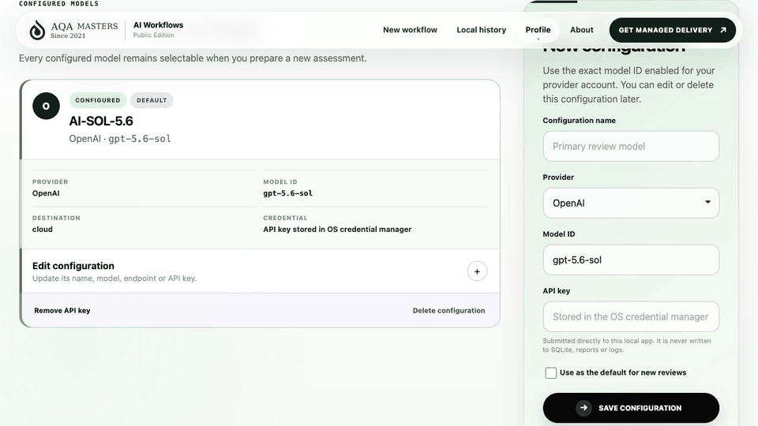
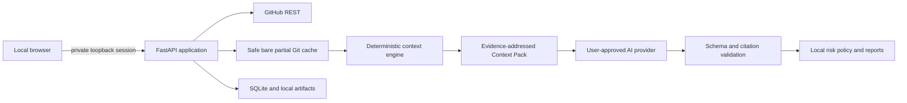

# AQA AI Workflows Public Edition

> Paste an open GitHub pull request. Understand what may change, what may break, and what to test first—with repository evidence you can inspect.

AQA AI Workflows Public Edition is a free, open-source, local application from AQA Masters. It builds a bounded model of a pull request, the repository around it, and up to three related repositories. Your chosen AI model turns that context into a Product brief, ranked risk hypotheses, test scenarios, exploratory charters, and a cross-service impact view.

It is not hosted by AQA Masters. There is no AQA account, backend, API proxy, telemetry, license server, source upload, product execution, or automatic update call.

## See it in use

This end-to-end recording follows one real HTTPX review from the local Profile and its securely stored credential status through PR setup, Context Pack approval, model execution, and the finished Product brief, QA testing, and Service impact views. The credential value is never exposed.



## Start in three steps

1. Install [Python 3.12–3.14](https://www.python.org/downloads/) and [Git 2.42+](https://git-scm.com/downloads).
2. Clone or download [aqamasters/ai-workflows-pe](https://github.com/aqamasters/ai-workflows-pe) and enter the `ai-workflows-pe` directory.
3. Run `./start` on macOS/Linux or double-click `start.cmd` on Windows.

The launcher creates an isolated `.venv`, installs pinned dependencies, starts a random-port server on `127.0.0.1`, opens a private launch URL, and shows friendly diagnostics if something is missing.

For private repositories, sign in with GitHub CLI first or enter a fine-grained read-only token in the local UI. Configure AI providers, exact model IDs, compatible endpoints, and API keys from the local **Profile** page. API keys are stored only through the operating-system credential manager.

## The real workflow

1. Paste one open GitHub PR URL.
2. Configure one or more AI models in **Profile**, then select a configured model for the review.
3. Optionally add product context and up to three related repository/PR links.
4. The app reads GitHub and builds safe bare partial-clone caches—no checkout and no source execution.
5. Inspect the exact provider, model, commit pins, evidence units, selected bytes, token estimate, redactions, and exclusions.
6. Approve transmission.
7. If the model requests material extra context, inspect and approve the revised pack; nothing newly selected is sent automatically.
8. Inspect the Product, QA, service-impact, and evidence views; export Markdown, HTML, or canonical JSON.
9. Delete the assessment and derived local artifacts at any time.

## What it produces

- concise change and intended-outcome summary;
- affected users, journeys, rules, data, interfaces, operations, and rollout considerations;
- missing or conflicting product questions;
- evidence-backed risk hypotheses ranked by a deterministic local policy;
- prioritized manual, exploratory, API, integration, UI, accessibility, performance, security, and data scenarios;
- related-service impact labeled explicit, structural, or inferred;
- exact evidence appendix and provider-transmission receipts;
- Product and QA Markdown, standalone HTML, canonical JSON, and transmission manifest.

Every report says:

> **Analysis only.** AQA AI Workflows Public Edition inspected source and repository context at the commits shown. It did not run the product or tests. Risks are hypotheses for human review, not verified defects or a release decision.

## Public Edition versus AQA Managed Delivery

| Capability | Public Edition | AQA Managed Delivery |
|---|---|---|
| Primary outcome | Direction for an open PR | Ongoing release confidence and QA execution |
| Product context | Inferred from selected repositories and user notes | Continuously learned through people, meetings, systems, customers, and delivery history |
| Change-impact review | Bounded, local, evidence-backed analysis | Maintained across the agreed product and service landscape |
| QA architecture | Public AQA method | Client-specific QA Architect direction and roadmap |
| Quality ownership | User interprets and acts on the report | QA Lead owns priorities, operating rhythm, and reporting |
| Hands-on execution | None | Embedded QE performs manual QA, meetings, investigation, and day-to-day follow-through |
| Automation and specialist work | Scenarios only—no code or execution | AI-Augmented QE builds and maintains agreed UI, API, integration, accessibility, performance, and CI work |
| AI governance | User chooses the provider/model and approves every Context Pack | Human-governed workflows maintained inside the engagement |
| Release evidence | Hypotheses and testing direction | Maintained human-reviewed evidence within agreed responsibility |
| Assets | Local reports and canonical data | Client-owned tests, automation, workflows, reports, and QA knowledge |

The Public Edition demonstrates how AQA thinks. Managed Delivery adds durable product understanding, human judgment, execution, maintenance, and accountability.

## Privacy and network boundary

| Destination | What goes there |
|---|---|
| GitHub | Read-only REST and Git requests for the explicitly registered repositories |
| Selected cloud AI | Only the approved Context Pack, AQA method prompt, schema, and prior validated review round |
| Local compatible model | The same Context Pack remains on the machine; GitHub traffic is still needed for remote repositories |
| AQA Masters | No automatic traffic. The browser navigates there only when you explicitly click a Managed Delivery link |

AI provider credentials are accepted only through Profile and stored by the operating-system credential manager. Credentials never enter Git URLs or command arguments and are never written to SQLite, settings, logs, reports, prompts, or exports. The app binds only to loopback, uses a high-entropy launch session, validates Host and Origin, requires CSRF tokens, sets a restrictive Content Security Policy, and loads no remote browser assets.

Read [Security and privacy](docs/SECURITY_AND_PRIVACY.md) and the [threat model](docs/THREAT_MODEL.md) before using private or sensitive repositories.

## Architecture



The code uses a small ports-and-adapters architecture: domain contracts and risk policy are provider-independent; GitHub, Git, context selection, providers, persistence, reporting, and the browser are replaceable adapters. See [Architecture](docs/ARCHITECTURE.md).

## Supported inputs and honest limits

- Primary input: one open or draft `github.com` pull request.
- Related context: up to three GitHub repository or PR URLs.
- Python receives AST symbol extraction; other languages receive deterministic topology and lexical analysis in v1.
- The app reads selected blobs from exact commits but never checks out or runs target source.
- It does not install target packages, run builds/tests, invoke hooks, initialize submodules, run LFS filters, crawl arbitrary webpages, or mutate GitHub.
- A bounded context model can miss dynamic behavior, undocumented product rules, remote runtime configuration, or services not explicitly supplied.

See [Limitations](docs/LIMITATIONS.md) and the [AQA AI Workflows Public Edition method](docs/METHOD.md).

## Commands

```text
./start --no-browser       Start locally and print the private URL
aqa-ai-workflows doctor          Check Python, Git, storage, SQLite and loopback
aqa-ai-workflows repair          Verify local state and recreate directories
aqa-ai-workflows export-schemas  Export the public JSON contracts
aqa-ai-workflows version         Print the installed version
```

When running without package installation, use `PYTHONPATH=src .venv/bin/python -m aqa_ai_workflows_pe.cli doctor`.

## Documentation

- [Source repository](https://github.com/aqamasters/ai-workflows-pe)
- [Issues](https://github.com/aqamasters/ai-workflows-pe/issues)
- [User guide](docs/USER_GUIDE.md)
- [Architecture](docs/ARCHITECTURE.md)
- [Production readiness](docs/PRODUCTION_READINESS.md)
- [Frontend system](docs/FRONTEND_SYSTEM.md)
- [AI workflow method and risk policy](docs/METHOD.md)
- [Provider setup and data behavior](docs/PROVIDERS.md)
- [Private repositories and GitHub permissions](docs/GITHUB_PRIVATE_REPOS.md)
- [Security and privacy](docs/SECURITY_AND_PRIVACY.md)
- [Threat model](docs/THREAT_MODEL.md)
- [Development and testing](docs/DEVELOPMENT.md)
- [Release process](docs/RELEASE.md)
- [Limitations](docs/LIMITATIONS.md)
- [Contributing](CONTRIBUTING.md)
- [Security reporting](SECURITY.md)

## License

Apache License 2.0. See [LICENSE](LICENSE) and [NOTICE](NOTICE).
