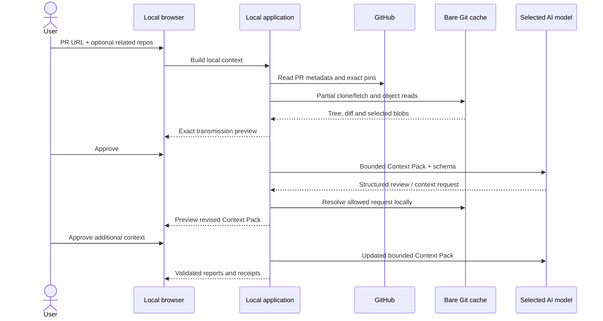

# Architecture

## Quality attributes

The Public Edition optimizes for local trust, bounded data disclosure, deterministic provenance, portability, and maintainability. It does not optimize for multi-user hosting, fleet management, continuous execution, or managed-delivery scale.

## Components

| Component | Responsibility | Trust boundary |
|---|---|---|
| Local launcher | Python validation, `.venv`, pinned install, loopback start | Local machine |
| Browser UI | Nontechnical setup, context approval, progress, reports, deletion | Untrusted browser input |
| Application service | Two-phase prepare/approve/review workflow | Trusted orchestration |
| GitHub adapter | Strict URL parsing and read-only REST | GitHub network |
| Git adapter | Bare partial clone, exact commits, safe object reads and diff | Untrusted repository objects |
| Context engine | Manifest, deterministic selection, redaction, evidence IDs | Local-only computation |
| AI adapters | Direct structured-output calls to selected provider | Explicit provider network |
| Validation and risk policy | Citation filtering, duplicate removal, prohibited-claim guard, local ranking | Trusted domain logic |
| SQLite/artifacts | AI-profile metadata, durable status, canonical results, exports, prepared Context Packs | User-local filesystem |
| OS credential manager | API keys addressed by opaque local AI-profile IDs | Operating-system account |

## Two-phase data flow

The Context Pack is saved locally before approval so the browser may close and reopen. AI-model profile metadata is stored in SQLite, while API keys are stored separately by the operating-system credential manager. Assessments retain the opaque profile ID needed to resolve their configured credential after a process restart.

AI provider credentials have one owner and one entry point: the local Profile UI. Context preparation does not load the provider key; the key is resolved from the OS credential manager only after the user approves the exact Context Pack, then held only for the lifetime of that review task.

## Git safety model

- Git commands are fixed argument arrays with `shell=False`.
- Remotes come only from GitHub API clone URLs after strict `github.com` input parsing.
- Tokens travel through a process-scoped askpass environment and never enter URLs or arguments.
- Caches are bare and filtered with `blob:none`; no working tree exists.
- Hooks, credential helpers, external diff, textconv, LFS smudge/process, optional locks, prompts, and non-HTTPS protocols are disabled for app commands.
- Tree paths, object IDs, entry count, blob size, diff size, and time are validated and bounded.
- Blobs are read by validated object ID, never by user-controlled command syntax.

## Context selection

The deterministic first pass creates:

1. PR intent evidence.
2. Per-file diff evidence.
3. Repository manifests: languages, packages, tests, contracts, docs, parser coverage, exclusions.
4. Selected changed-file bodies, manifests, matching tests, contracts, docs, and related-repository candidates.
5. Secret redactions, evidence hashes, byte count, and token estimate.

The model may request at most two additional bounded rounds. A request specifies only a registered repository alias, allowed kind, query, reason, and maximum result count. It cannot supply a URL, ref, path traversal, shell command, tool call, or new repository. Every expansion is built locally and pauses at the approval page; no newly selected evidence is sent automatically.

## Provider isolation

Provider-specific payload and response shapes live in `adapters/ai`. All providers return the same strict `ProviderReview` contract. The canonical domain and report layers do not import provider SDK types. No provider silently falls back to another model or endpoint.

## Persistence, task ownership and recovery

SQLite uses WAL, foreign keys, synchronous normal, secure deletion, a schema version, explicit connection lifetimes, and short transactions. Assessment state and results are JSON-validated on read. Context Packs and reports use canonical assessment UUIDs, private directories, and atomic write-and-replace. Background tasks are owned by assessment ID, cancelled before deletion, and cancelled during application shutdown. On process startup, interrupted active work becomes an honest failed state; prepared assessments remain available for approval.

Provider responses are streamed through a local size bound before parsing. Provider error bodies are treated as untrusted and are not reflected into the browser. Only locally authored status mappings and bounded provider request IDs may reach the UI.

## Public/managed boundary

This architecture is intentionally not the AQA Managed Delivery platform architecture. It contains no tenant model, scheduler, queue, worker fleet, webhook ingestion, source indexing service, continuous QA state, collaboration, managed provider gateway, execution infrastructure, billing, or AQA control plane.
